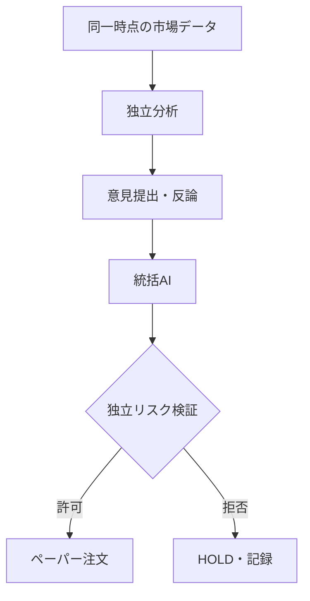

# AI組織会議方式（将来設計）

ユーザー決定: C方式。各専門AIが独立した分析と意見を提出し、相互に反論・検証したうえで統括AIが最終判断する。独立リスク管理プログラムが拒否権を持つ。

## 役割案（未実装）

| 役割 | 責務 |
|---|---|
| 市場分析Bot | トレンド、出来高、価格変動を評価 |
| 戦略Bot | 売買候補、根拠、撤退条件を提示 |
| リスク分析Bot | 下落リスク、集中、資金配分を評価 |
| 反論Bot | 根拠の弱さ、矛盾、反対シナリオを検証 |
| 統括AI | 意見を統合しBUY/SELL/HOLD候補を決定 |
| 独立リスク管理 | 機械的ルールに基づき拒否・停止 |

## 設計上の推奨

- 各意見にデータ時刻、根拠、反対材料、確信度を記録。
- AIの出力を構造化し、形式不正・タイムアウト・データ欠損時はHOLD。
- 同じモデルを複数回呼ぶだけでは独立性や精度は保証されない。
- AIは直接注文権限を持たない。リスク検証を迂回できない設計にする。
- 会議ログ、モデル名、判断理由、API費用を保存し、単一AIとの比較実験を行う。

役割数、モデル、会議回数、投票方式の詳細は未決定。
