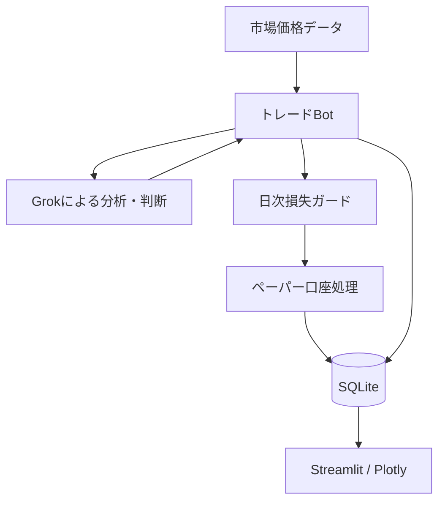

# システム構成

## 現行構成（会話記録から確認できる範囲）

図は概念構成であり、実際の関数呼び出し順序はソースと照合が必要。

確認されたモジュール・データ:
- `app/dashboard.py`: 表示・履歴読み込み。
- `app/db.py`: `cash()`, `positions()`, `query()`, `kv()`, `set_kv()`, `save_equity_snapshot()` の呼び出しが確認されている。
- `app/config.py`: 設定管理。最新設定値は要照合。
- `cycles`, `equity_history`: SQL参照が確認されたテーブル。

## 資産計算

総資産 = 現金 + 各保有数量 × 現在価格の合計。

確認されたコードでは価格欠損時に0を使用している。欠損を本当の価格ゼロと誤認しないよう、取引停止・エラー記録・有効価格の検証を推奨する。

## 日次損失ガード

UTC日付をキーに日初資産を保存し、現在資産と設定損失率を比較する。日初値の初期化、再起動、UTC日付変更、欠損価格をテストする。ガード発動後の停止継続や再開条件は最新コードと照合する。
